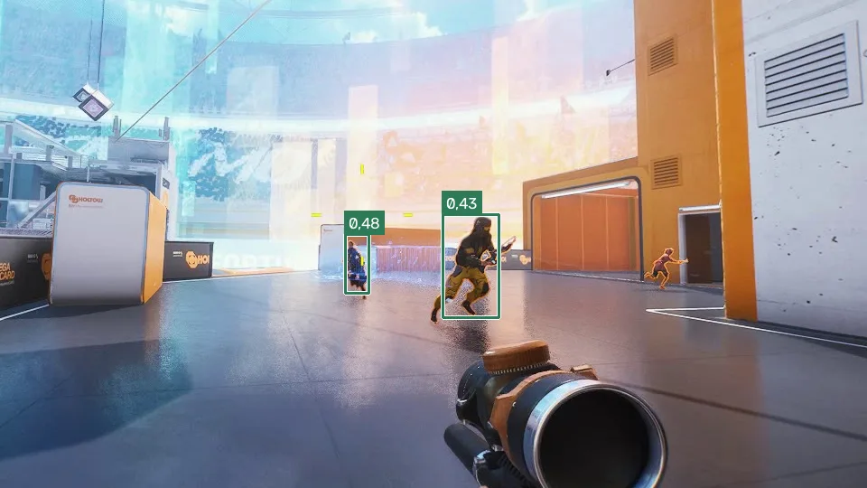

# Détection de silhouettes en temps réel

Projet personnel (2025), preuve de concept. Question de départ : un détecteur YOLO peut-il
repérer de loin, dans le jeu The Finals, des silhouettes que l'œil ne voit pas forcément, et
afficher ses boîtes en temps réel dans une surcouche transparente qui ne bloque pas l'écran ?



*Sortie réelle du modèle sur une de mes captures (seuil de confiance 0,35, image recadrée). Le
joueur de droite n'est pas détecté.*

## Ce que fait le code

| Fichier | Rôle |
| --- | --- |
| `record.ipynb` | Enregistre l'écran, puis extrait une image toutes les deux secondes pour l'annotation. |
| `entity.ipynb` | Premier essai avec un YOLO11x pré-entraîné (classe « personne »), sans entraînement. |
| `et.py` | Capture d'écran (`mss`), inférence YOLO, surcouche PyQt5 avec classe et score de confiance. |
| `entity.py` | Variante allégée : inférence sur l'image réduite de moitié, seuil de confiance 0,75, lissage exponentiel des boîtes. |

Les deux scripts chargent `best.pt` placé à côté d'eux ; un autre fichier de poids peut être passé
en premier argument : `python entity.py chemin/vers/poids.pt`. Les poids entraînés ne sont pas
publiés (voir « Usage »).

## Entraînements réalisés

Les trois entraînements utilisent Ultralytics en 640 px, lot de 16. Les métriques sont celles de
l'ensemble de validation, lues dans les fichiers `results.csv` produits par Ultralytics.

| Données | Modèle | Époques | Précision | Rappel | mAP50 | mAP50-95 |
| --- | --- | --- | --- | --- | --- | --- |
| Jeu public Roboflow « The Finals » v5, 6 762 images (5 919 / 563 / 280) | YOLO11n | 100 | 0,963 | 0,945 | 0,972 | 0,715 |
| Mes propres captures annotées, 326 images après augmentation | YOLO11n | 50 | 0,704 | 0,313 | 0,325 | 0,211 |
| Même jeu public, ré-exporté en 640 px | YOLO11x | 4 (arrêté) | 0,596 | 0,533 | 0,539 | 0,253 |

`best.pt` est le premier modèle du tableau.

## Ce que ces chiffres ne disent pas

- La validation vient du même jeu de données que l'entraînement : mêmes décors, mêmes conditions
  de capture. Le score de 0,97 ne dit rien de la tenue sur d'autres images, et `best.pt` n'a pas
  été évalué sur mes propres captures.
- Mes propres captures étaient trop peu nombreuses : le modèle entraîné dessus manque deux
  silhouettes sur trois.
- Le YOLO11x demandait environ 25 minutes par époque sur ma machine ; je l'ai arrêté après quatre.
- Essai qualitatif sur 136 de mes captures, au seuil de 0,35 : le modèle détecte quelque chose
  sur 47 d'entre elles, avec des faux positifs sur des icônes de l'interface et des joueurs
  manqués, comme sur l'image ci-dessus. Ces captures n'étant pas annotées, ni précision ni rappel
  n'en sont tirés.
- La latence de bout en bout (capture, inférence, affichage) n'a pas été mesurée. Le seul temps
  relevé est celui de l'inférence du YOLO11x pré-entraîné en 384 × 640 : 17 ms en médiane sur
  471 images, 20 ms au 95e centile.

## Données

Les jeux de données ne sont pas dans ce dépôt. Les deux jeux publics viennent de Roboflow Universe
(licence CC BY 4.0) :

- `synsenetwork/the-finals-e313v`, version 5 ;
- `entity-euj3h/the-finals-e313v-ludpf`, version 1.

## Usage

Le but était de vérifier que c'était possible, pas de s'en servir : utilisée pendant une partie
en ligne, une surcouche de ce type serait de la triche. Elle n'a jamais servi en partie. Pour la
même raison, les poids entraînés (`best.pt`) ne sont pas publiés.

## Installation

```sh
pip install -r requirements.txt
python et.py chemin/vers/poids.pt
```

Sans poids entraînés, un modèle Ultralytics pré-entraîné comme `yolo11n.pt` détecte la classe
« personne » générique.
